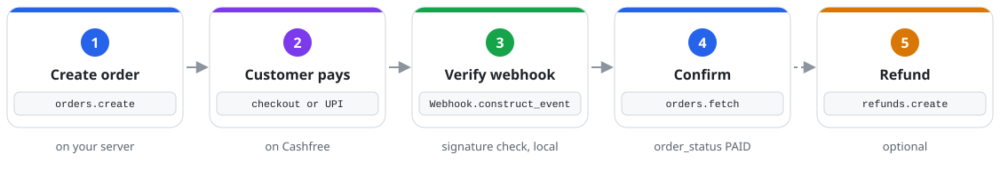

<div align="center">


**Orders, payments, UPI, refunds, payment links and webhook verification<br>for the Cashfree Payment Gateway, from plain Ruby or Rails.**

[](https://github.com/Shadbox-Infosystem/cashfree_pg/actions/workflows/ci.yml)
[](cashfree_pg.gemspec)
[](docs/api.md)
[](LICENSE.txt)

[Quick start](#-quick-start) · [Payment flow](#-payment-flow) · [Rails](#-rails-integration) · [API reference](docs/api.md) · [Webhooks](docs/webhooks.md) · [Sandbox testing](#-sandbox-testing)

</div>

> [!IMPORTANT]
> **Community project, not an official SDK.** `cashfree_pg` is built and maintained independently. It is not affiliated with, endorsed by, or supported by Cashfree Payments.

## ⚡ Overview

`cashfree_pg` wraps the Cashfree Payment Gateway (PG) REST API in a small, instance-based Ruby interface. It keeps Cashfree's own field names, so Cashfree's docs still apply, and it handles the parts that are easy to get wrong in a payment integration.

> **You write:** `client.orders.create(order_id: "order_42", order_amount: "499.00", ...)`<br>
> **You get:** a `Response` with Cashfree's fields, amounts as `BigDecimal`, the `request_id` for support, and a typed exception for every failure. No raw HTTP, no `Float` money, no secrets in your logs.

The gem talks only to Cashfree over HTTPS. It never handles card data, and it has no telemetry, request logging or automatic retries. Faraday is its only runtime dependency.

<table>
  <tr>
    <td width="33%" valign="top"><h4>🧾 Orders</h4>Create, fetch and terminate, with an optional idempotency key.</td>
    <td width="33%" valign="top"><h4>💳 Payments</h4>List and fetch, plus capture or void pre-authorised payments.</td>
    <td width="33%" valign="top"><h4>📱 UPI</h4>Intent, QR and collect on the order session, without sending your secret.</td>
  </tr>
  <tr>
    <td valign="top"><h4>↩️ Refunds</h4>Create with your own <code>refund_id</code>, then fetch or list.</td>
    <td valign="top"><h4>🔗 Payment Links</h4>Create, fetch and cancel, and find the orders a paid link created.</td>
    <td valign="top"><h4>🔐 Webhooks</h4>Constant-time HMAC-SHA256 check, optional timestamp window.</td>
  </tr>
  <tr>
    <td valign="top"><h4>🧯 Typed Errors</h4>One exception per HTTP status, with Cashfree's <code>code</code> and <code>request_id</code>.</td>
    <td valign="top"><h4>💰 Exact Money</h4>Two-decimal JSON amounts out, <code>BigDecimal</code> back in.</td>
    <td valign="top"><h4>🛡️ Safe Defaults</h4>HTTPS only, TLS verified, secret redacted from <code>inspect</code> and errors.</td>
  </tr>
</table>

## 🔄 Payment flow

How one payment moves through your app, `cashfree_pg` and Cashfree:

<p align="center">
  <picture>
    <source media="(prefers-color-scheme: dark)" srcset="docs/assets/payment-flow-dark.svg">
    
  </picture>
</p>

- 🔁 **Retries are yours.** The gem never retries. Reuse your own `order_id` or `refund_id` and the call is safe to repeat.
- 🔔 **Verify, then confirm.** Check the webhook signature, deduplicate repeats, and fetch the order before you fulfil it.
- 🧾 **Log the `request_id`.** Every response and error carries one, and it is what Cashfree support asks for.

## 🚀 Quick start

| Requirement | Version |
| --- | --- |
| Ruby | 3.3 or newer |
| Cashfree account | PG API credentials, sandbox or production |

**1. Install.** Add the gem to your `Gemfile` and run `bundle install`:

```ruby
gem "cashfree_pg", "~> 0.1.0"
```

**2. Create a client.** There is no global configuration: credentials live on the instance, one client per merchant account. The gem reads nothing from `ENV` itself.

```ruby
require "cashfree_pg"

client = CashfreePg::Client.new(
  client_id:     ENV.fetch("CASHFREE_CLIENT_ID"),
  client_secret: ENV.fetch("CASHFREE_CLIENT_SECRET"),
  environment:   :sandbox # or :production, with production credentials
)
```

**3. Take a payment.**

```ruby
order = client.orders.create(
  order_id:         "order_#{SecureRandom.hex(6)}",
  order_amount:     "499.00", # String, Integer or BigDecimal; never Float
  order_currency:   "INR",
  customer_details: { customer_id: "cust_42", customer_phone: "9999999999" }
)

order.payment_session_id # hand this to Cashfree checkout on the frontend
client.orders.fetch(order.order_id).order_status # => "ACTIVE", "PAID", ...
```

<details>
<summary><b>All client options</b></summary>

<br>

| Option | Default | Notes |
| --- | --- | --- |
| `client_id` | required | Your Cashfree PG app id. |
| `client_secret` | required | Never shown by `inspect`, `to_s` or `pp`. Also the webhook signing secret. |
| `environment` | `:sandbox` | `:sandbox` (`sandbox.cashfree.com/pg`) or `:production` (`api.cashfree.com/pg`). Must be a Symbol. |
| `api_version` | `"2025-01-01"` | Sent as `x-api-version` on every call. |
| `open_timeout` | `30` | Seconds to wait for a connection. |
| `read_timeout` | `60` | Seconds to wait for a response. |

[`.env.example`](.env.example) lists the variable names this repository's tooling uses. Never commit real credentials; `.env` is git-ignored.

To try unreleased changes, install from GitHub: `gem "cashfree_pg", github: "Shadbox-Infosystem/cashfree_pg", branch: "main"`.

</details>

## 📦 Usage

Single objects come back as a `CashfreePg::Response`, with Cashfree's field names exactly:

```ruby
order.order_status                          # field as a method
order["order_amount"]                       # => BigDecimal("499.0")
order.dig(:customer_details, :customer_id)  # use [] or dig for keys like hash or class
order.request_id                            # quote this to Cashfree support
```

`payments.list` and `payment_links.orders` return an Array of `Response`. Every method and its Cashfree endpoint is listed in [docs/api.md](docs/api.md).

<details>
<summary><b>UPI: intent, QR and collect</b></summary>

<br>

```ruby
client.payments.upi(order, channel: :intent)  # sent as Cashfree's "link"
client.payments.upi(order, channel: :qr)      # sent as "qrcode"
client.payments.upi(order, channel: :collect, upi_id: "testsuccess@gocash")
client.payments.upi(order.payment_session_id, channel: :qr, upi_expiry_minutes: 10)
```

Calling Order Pay from a server needs Cashfree's S2S feature on your account. Without it, Cashfree returns 403 and the gem raises `CashfreePg::PermissionError` saying so.

</details>

<details>
<summary><b>Payments and pre-authorisation</b></summary>

<br>

```ruby
payments = client.payments.list(order.order_id)
client.payments.fetch(order.order_id, payments.first.cf_payment_id)

client.payments.authorize(order.order_id, action: :capture, amount: "499.00", idempotency_key: "cap_1")
client.payments.authorize(order.order_id, action: :void, idempotency_key: "void_1")
```

</details>

<details>
<summary><b>Refunds</b></summary>

<br>

```ruby
client.refunds.create(order.order_id, refund_amount: "499.00", refund_id: "refund_00912")
client.refunds.fetch(order.order_id, "refund_00912")
client.refunds.list(order.order_id)
```

Always pass your own `refund_id`. If a create times out, fetch that id before trying again; a duplicate raises `CashfreePg::ConflictError`.

</details>

<details>
<summary><b>Payment links</b></summary>

<br>

```ruby
link = client.payment_links.create(
  link_id: "link_123", link_amount: "499.00", link_currency: "INR", link_purpose: "Invoice 1042",
  customer_details: { customer_phone: "9999999999" }
)
link.link_url                                   # send this to the customer
client.payment_links.cancel(link.link_id)       # ACTIVE links only

paid = client.payment_links.orders(link.link_id) # Cashfree creates the order when the link is paid
client.refunds.create(paid.first.order_id, refund_amount: "499.00", refund_id: "refund_link_1")
```

</details>

<details>
<summary><b>Terminating orders and calling other endpoints</b></summary>

<br>

```ruby
client.orders.terminate(order.order_id).order_status # => "TERMINATED" or "TERMINATION_REQUESTED"
client.get("/orders/order_123") # any PG endpoint, same auth headers, errors and Response
```

`client.get`, `client.post` and `client.patch` take paths relative to `/pg`.

</details>

## 🧯 Error handling

Every exception inherits from `CashfreePg::Error` and exposes `status`, `code`, `type` and `request_id`. Messages never contain the client secret.

```ruby
begin
  order = client.orders.create(order_id: "order_123", order_amount: "499.00", order_currency: "INR",
                               customer_details: { customer_id: "cust_42", customer_phone: "9999999999" })
rescue CashfreePg::ConflictError, CashfreePg::TimeoutError
  order = client.orders.fetch("order_123") # already exists, or outcome unknown: check, don't recreate
rescue CashfreePg::Error => e
  warn "Cashfree #{e.class}: status=#{e.status} code=#{e.code} request_id=#{e.request_id}"
  raise
end
```

HTTP 400, 401, 403, 404, 409, 422 and 429 each have their own class; 5xx raises `APIError`, and a missing response raises `ConnectionError` or `TimeoutError`. The full mapping is in [docs/api.md](docs/api.md#errors). Bad local input, such as a blank id or an unknown UPI channel, raises `ArgumentError` before any request is sent.

## 🚂 Rails integration

No Railtie needed: an initializer, a service object, and a controller for webhooks.

```ruby
# config/initializers/cashfree.rb
CASHFREE = CashfreePg::Client.new(
  client_id:     ENV.fetch("CASHFREE_CLIENT_ID"),
  client_secret: ENV.fetch("CASHFREE_CLIENT_SECRET"),
  environment:   ENV.fetch("CASHFREE_ENVIRONMENT", "sandbox").to_sym
)

# app/services/cashfree_checkout.rb
class CashfreeCheckout
  def self.call(order_id:, amount:, customer_id:, phone:)
    CASHFREE.orders.create(
      order_id: order_id, order_amount: amount.to_s, order_currency: "INR",
      customer_details: { customer_id: customer_id, customer_phone: phone }
    ).payment_session_id
  end
end

# app/controllers/cashfree_webhooks_controller.rb  (route: post "/webhooks/cashfree")
class CashfreeWebhooksController < ActionController::API
  def create
    event = CashfreePg::Webhook.construct_event(
      raw_body: request.raw_post,
      headers:  request.headers,
      secret:   ENV.fetch("CASHFREE_CLIENT_SECRET")
    )
    CashfreeEventJob.perform_later(event.type, event.data) # your job; deduplicate there
    head :ok
  rescue CashfreePg::SignatureVerificationError
    head :bad_request
  end
end
```

> [!WARNING]
> Pass `request.raw_post`, never parsed params. Re-encoding changes amounts like `10.10` and the signature will not match. See [docs/webhooks.md](docs/webhooks.md) for deduplication, the optional `tolerance:` window and Cashfree's IP allow-list.

## 🧪 Sandbox testing

**Unit specs run on every push.** RSpec with WebMock (real network blocked) covers every resource method, headers, money handling, each HTTP status mapping, timeouts, secret redaction and webhook signatures. SimpleCov fails the run below 90% line coverage, and [CI](.github/workflows/ci.yml) runs on Ruby 3.3, 3.4 and latest, with `bundler-audit` and a `gitleaks` secret scan.

**Integration specs hit the real sandbox.** [`spec/integration/sandbox_spec.rb`](spec/integration/sandbox_spec.rb) runs against `sandbox.cashfree.com/pg` when you provide credentials. It skips without them, refuses to run with `CASHFREE_ENVIRONMENT=production`, and does not run in CI.

| Flow | Verified against the sandbox |
| --- | --- |
| Order → UPI intent → payments | `payment_session_id` returned, intent channel is `link`, payments list is an Array |
| Terminate | Unpaid order becomes `TERMINATED` or `TERMINATION_REQUESTED` |
| Payment link lifecycle | Created, fetched, orders listed, cancelled |
| Refund | Created on a paid order and fetched by `refund_id` (needs `CASHFREE_PAID_ORDER_ID`) |

```bash
cp .env.example .env                  # sandbox credentials only
set -a; source .env; set +a
bundle exec rspec spec/integration
bin/console                           # IRB with the gem loaded, sandbox only
```

<details>
<summary><b>Sandbox test values</b></summary>

<br>

| Value | Effect in sandbox |
| --- | --- |
| `upi_id: "testsuccess@gocash"` | Successful UPI collect |
| `refund_note: "SUCCESS"`, `"FAILED"`, `"PENDING"`, `"ACTIVE"` | Simulates that refund status |
| `link_notify: { send_email: true }` | Sandbox sends email; SMS is production only |

</details>

## 🧭 Coverage and roadmap

| Status | Scope |
| :---: | --- |
| ✅ | Orders, payments, pre-authorisation, UPI (intent, QR, collect), refunds, payment links |
| ✅ | Webhook verification, typed errors, exact money, RBS signatures, idempotency keys |
| 🚧 | First RubyGems release (v0.1.0) through the trusted-publishing [release workflow](.github/workflows/release.yml) |
| 📋 | Stabilise the public API for v1.0 |
| 📋 | More PG endpoints, such as Order Pay for cards and netbanking, settlements and subscriptions |

Until v1.0, a minor release may include breaking changes, listed in the [changelog](CHANGELOG.md). Pin with `~> 0.1.0` to get only patch updates. Missing something? [Open an issue](https://github.com/Shadbox-Infosystem/cashfree_pg/issues) before starting larger work.

## 🤝 Contributing

Bug reports and pull requests are welcome. This gem sits in payment flows, so correctness and security come before new features. Read [CONTRIBUTING.md](CONTRIBUTING.md) first.

```bash
git checkout dev && git checkout -b fix/short-description
bin/setup            # install dependencies
bundle exec rake     # specs, RuboCop, RBS validation and gem contents check
```

Match new endpoints to Cashfree's current API reference, cover them with RSpec and WebMock, never use `Float` for amounts, add a line under `[Unreleased]` in [CHANGELOG.md](CHANGELOG.md), and open the pull request against `dev`. Never put real credentials or customer data in code, fixtures or screenshots. Report vulnerabilities privately as described in [SECURITY.md](SECURITY.md). Everyone taking part follows the [code of conduct](CODE_OF_CONDUCT.md).

## 📄 License

Released under the [MIT License](LICENSE.txt). Copyright © 2026 Muballigh Faraz.

"Cashfree" and "Cashfree Payments" are names of their respective owner, used here only to describe which API this library talks to. For official SDKs and support, see [cashfree.com](https://www.cashfree.com).

<br>

<div align="center">

**Built for the Ruby community ❤️**

<sub><code>cashfree_pg</code> · Unofficial Ruby Client for Cashfree Payments</sub>

</div>
