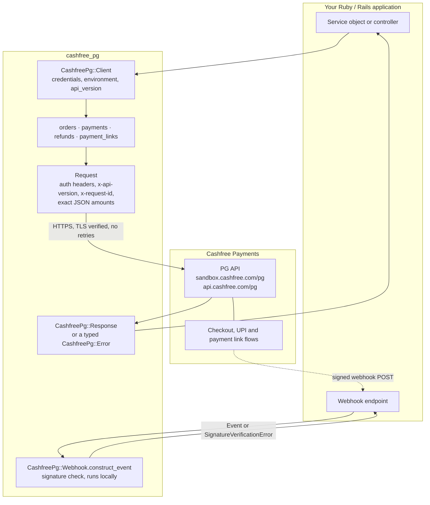

<div align="center">


Orders, payments, UPI, refunds, payment links and webhook verification for the
Cashfree Payment Gateway API, from plain Ruby or Rails.

<br>

[](https://github.com/Shadbox-Infosystem/cashfree_pg/actions/workflows/ci.yml)
[](cashfree_pg.gemspec)
[](docs/api.md)
[](LICENSE.txt)

<br>

**Build payment integrations in Ruby without writing raw HTTP calls.**

[Quick start](#quick-start) •
[Features](#features) •
[API reference](docs/api.md) •
[Webhooks](docs/webhooks.md) •
[Sandbox testing](#-sandbox-testing) •
[Contributing](#contributing)

</div>

<br>

> [!IMPORTANT]
> **Community project, not an official SDK.** `cashfree_pg` is built and maintained independently. It is not affiliated with, endorsed by, or supported by Cashfree Payments.

> [!NOTE]
> **Pre-release.** v0.1.0 is ready in this repository but has not been published to RubyGems yet. Install from GitHub for now. The public API may change before v1.0.

---

## Overview

`cashfree_pg` wraps the Cashfree Payment Gateway (PG) REST API in a small Ruby interface. You create a client with your credentials, call methods such as `client.orders.create`, and get back response objects and typed exceptions instead of status codes and JSON strings.

It is for Ruby and Rails developers who take payments in India through Cashfree and want an integration that stays close to Cashfree's own field names, without hiding what goes over the wire.

The gem talks only to Cashfree over HTTPS. It never connects to NPCI or a bank, never handles raw card data, and has no telemetry, request logging, or automatic retries.

<br>

## Features

<table>
  <tr>
    <td width="33%" valign="top">
      <h4>🧾 Orders</h4>
      Create, fetch and terminate orders. Optional idempotency key on create.
    </td>
    <td width="33%" valign="top">
      <h4>💳 Payments</h4>
      List and fetch payments for an order. Capture or void pre-authorised payments.
    </td>
    <td width="33%" valign="top">
      <h4>📱 UPI</h4>
      Intent, QR and collect on the order session, without sending your client secret.
    </td>
  </tr>
  <tr>
    <td width="33%" valign="top">
      <h4>↩️ Refunds</h4>
      Create refunds with your own <code>refund_id</code>, then fetch or list them.
    </td>
    <td width="33%" valign="top">
      <h4>🔗 Payment Links</h4>
      Create, fetch and cancel links, and find the orders a paid link created.
    </td>
    <td width="33%" valign="top">
      <h4>🔐 Webhook Verification</h4>
      Constant-time HMAC-SHA256 signature check with an optional timestamp window.
    </td>
  </tr>
  <tr>
    <td width="33%" valign="top">
      <h4>🧯 Typed Errors</h4>
      One exception class per HTTP status, each carrying Cashfree's <code>code</code> and <code>request_id</code>.
    </td>
    <td width="33%" valign="top">
      <h4>💰 Exact Money</h4>
      Amounts go out as two-decimal JSON numbers and come back as <code>BigDecimal</code>.
    </td>
    <td width="33%" valign="top">
      <h4>🛡️ Safe Defaults</h4>
      TLS verified, HTTPS only, client secret redacted from <code>inspect</code> and error messages.
    </td>
  </tr>
</table>

<br>

## How it works



Every outgoing call goes through a single request path that adds authentication and versioning headers, serialises amounts exactly, and maps non-2xx responses to exceptions. Webhook verification makes no network call: it checks the signature on the request your app already received.

<br>

## Installation

| Requirement | Version |
| --- | --- |
| Ruby | 3.3 or newer |
| Runtime dependency | `faraday` 2.x (the only one) |
| Cashfree account | PG API credentials (sandbox or production) |

**From GitHub (current).** Add this to your `Gemfile`, then run `bundle install`:

```ruby
gem "cashfree_pg", github: "Shadbox-Infosystem/cashfree_pg", branch: "main"
```

**From RubyGems (after the v0.1.0 release).** These commands will work once the gem is published:

```bash
gem install cashfree_pg
```

```ruby
gem "cashfree_pg", "~> 0.1.0"
```

<br>

## Configuration

There is no global configuration. You create a `CashfreePg::Client` with credentials, and those credentials stay on that instance. Use one client per merchant account.

```ruby
require "cashfree_pg"

client = CashfreePg::Client.new(
  client_id:     ENV.fetch("CASHFREE_CLIENT_ID"),
  client_secret: ENV.fetch("CASHFREE_CLIENT_SECRET"),
  environment:   :sandbox # or :production
)
```

| Option | Default | Notes |
| --- | --- | --- |
| `client_id` | required | Your Cashfree PG app id. |
| `client_secret` | required | Your Cashfree PG secret key. Never shown by `inspect`, `to_s` or `pp`. |
| `environment` | `:sandbox` | `:sandbox` or `:production`. Must be a Symbol; anything else raises `ArgumentError`. |
| `api_version` | `"2025-01-01"` | Sent as the `x-api-version` header on every call. |
| `open_timeout` | `30` | Seconds to wait for a connection. |
| `read_timeout` | `60` | Seconds to wait for a response. |

| Environment | Base URL |
| --- | --- |
| `:sandbox` | `https://sandbox.cashfree.com/pg` |
| `:production` | `https://api.cashfree.com/pg` |

**Credentials.** Sandbox and production use separate credentials from your Cashfree merchant dashboard. Start with sandbox credentials. Switch `environment:` to `:production` only together with production credentials.

**Environment variables.** The gem does not read anything from `ENV`; you pass values in. This repository's tooling uses the names below, and [`.env.example`](.env.example) is a template for local sandbox work:

| Variable | Used for |
| --- | --- |
| `CASHFREE_CLIENT_ID` | Client id, passed to `Client.new` |
| `CASHFREE_CLIENT_SECRET` | Client secret, also the webhook signing secret |
| `CASHFREE_ENVIRONMENT` | `sandbox` or `production`. Convert with `.to_sym` before passing it to `Client.new` |

> [!CAUTION]
> Never commit real credentials. `.env` is git-ignored; keep it that way.

<br>

## Quick start

Create a sandbox order, start a UPI intent payment on it, then check the order status.

```ruby
require "cashfree_pg"
require "securerandom"

client = CashfreePg::Client.new(
  client_id:     ENV.fetch("CASHFREE_CLIENT_ID"),
  client_secret: ENV.fetch("CASHFREE_CLIENT_SECRET"),
  environment:   :sandbox
)

# 1. Create an order. Pass amounts as Strings (or Integer / BigDecimal), never Float.
order = client.orders.create(
  order_id:         "order_#{SecureRandom.hex(6)}",
  order_amount:     "499.00",
  order_currency:   "INR",
  customer_details: { customer_id: "cust_42", customer_phone: "9999999999" }
)

order.order_id           # => "order_3f9c2a1b7d4e"
order.payment_session_id # => hand this to Cashfree checkout on the frontend

# 2. Or start UPI from your server. :intent needs no VPA.
upi = client.payments.upi(order, channel: :intent)
upi.channel # => "link" (Cashfree's name for UPI intent)

# 3. Check where the order stands.
client.orders.fetch(order.order_id).order_status # => "ACTIVE", "PAID", ...
```

> [!TIP]
> Calling Order Pay (`payments.upi`) from a server requires Cashfree's S2S feature on your account. Without it, Cashfree returns 403 and the gem raises `CashfreePg::PermissionError` with a message that says so.

### Working with responses

Calls that return one object give you a `CashfreePg::Response`. Field names are exactly Cashfree's.

```ruby
order.order_status             # field as a method
order["order_amount"]          # => BigDecimal("499.0")
order.dig(:customer_details, :customer_id)
order.to_h                     # plain Hash (or Array for list endpoints)
order.status                   # HTTP status
order.request_id               # x-request-id; quote this to Cashfree support
```

Use `[]` or `dig` for keys that collide with Ruby methods, such as `hash` or `class`. `payments.list` and `payment_links.orders` return an Array of `Response`.

<br>

## API coverage

Each method, its Cashfree endpoint, and a link to Cashfree's reference page are listed in [docs/api.md](docs/api.md).

| Area | Gem methods | Status |
| --- | --- | :---: |
| Orders | `orders.create`, `orders.fetch`, `orders.terminate` | ✅ |
| Payments | `payments.list`, `payments.fetch` | ✅ |
| Pre-authorisation | `payments.authorize(action: :capture / :void)` | ✅ |
| UPI (Order Pay) | `payments.upi(channel: :intent / :qr / :collect / :pod_qr)` | ✅ |
| Refunds | `refunds.create`, `refunds.fetch`, `refunds.list` | ✅ |
| Payment links | `payment_links.create`, `.fetch`, `.cancel`, `.orders` | ✅ |
| Webhook verification | `CashfreePg::Webhook.construct_event` | ✅ |
| Sandbox environment | `environment: :sandbox` | ✅ |
| Production environment | `environment: :production` | ✅ |
| Idempotency keys | `idempotency_key:` on create, capture and void | ✅ |
| Order Pay for cards, netbanking, wallets | none | ❌ |
| Settlements, payouts, subscriptions | none | ❌ |
| Legacy form-encoded webhooks | none | ❌ |

Endpoints without a wrapper can still go through the same authenticated request path with `client.get`, `client.post` and `client.patch`, using paths relative to `/pg`:

```ruby
client.get("/orders/order_123") # same auth headers, error mapping and Response object
```

### More examples

<details>
<summary><b>UPI: intent, QR and collect</b></summary>

<br>

```ruby
client.payments.upi(order, channel: :intent)
client.payments.upi(order, channel: :qr)
client.payments.upi(order, channel: :collect, upi_id: "testsuccess@gocash")

# A payment_session_id String works in place of the order.
client.payments.upi(order.payment_session_id, channel: :qr, upi_expiry_minutes: 10)
```

`:intent` is sent as Cashfree's channel `link`, and `:qr` as `qrcode`. `:collect` is the legacy flow and needs a VPA. Other Cashfree UPI fields, such as `upi_expiry_minutes`, are passed through.

</details>

<details>
<summary><b>Payments and pre-authorisation</b></summary>

<br>

```ruby
payments = client.payments.list(order.order_id)
client.payments.fetch(order.order_id, payments.first.cf_payment_id)

client.payments.authorize(order.order_id, action: :capture, amount: "499.00", idempotency_key: "cap_1")
client.payments.authorize(order.order_id, action: :void, idempotency_key: "void_1")
```

`:capture` requires an amount and `:void` must not have one.

</details>

<details>
<summary><b>Refunds</b></summary>

<br>

```ruby
client.refunds.create(order.order_id, refund_amount: "499.00", refund_id: "refund_00912", refund_note: "Customer request")
client.refunds.fetch(order.order_id, "refund_00912")
client.refunds.list(order.order_id).to_h # Cashfree's array, unchanged
```

Always pass your own `refund_id`. If a create times out, fetch that id before you try again. A duplicate id raises `CashfreePg::ConflictError`.

</details>

<details>
<summary><b>Payment links</b></summary>

<br>

```ruby
link = client.payment_links.create(
  link_id:          "link_123",
  link_amount:      "499.00",
  link_currency:    "INR",
  link_purpose:     "Invoice 1042",
  customer_details: { customer_phone: "9999999999", customer_email: "test@example.com" },
  link_notify:      { send_sms: false, send_email: false }
)

link.link_url                         # send this to the customer
client.payment_links.fetch(link.link_id)
client.payment_links.cancel(link.link_id) # ACTIVE links only

paid = client.payment_links.orders(link.link_id) # paid orders; status: "ALL" for every order
client.refunds.create(paid.first.order_id, refund_amount: "499.00", refund_id: "refund_link_1")
```

Cashfree creates the order when a link is paid, so use `payment_links.orders` to find the `order_id` to refund.

</details>

<details>
<summary><b>Terminating an order</b></summary>

<br>

```ruby
client.orders.terminate(order.order_id).order_status # => "TERMINATED" or "TERMINATION_REQUESTED"
```

Only unpaid orders can be terminated. If the status is `TERMINATION_REQUESTED`, fetch the order again to confirm it reached `TERMINATED`.

</details>

<br>

## 🧪 Sandbox Testing

The gem is tested at two levels: offline unit specs that run on every push, and integration specs that call the real Cashfree sandbox when you give them credentials.

### Unit specs (CI)

- RSpec with WebMock. Real network access is blocked, so nothing leaves the machine.
- Cover every resource method, header and money handling, mapping of each HTTP status to its error class, timeouts, connection failures, secret redaction, and webhook signatures (valid, tampered, wrong secret, missing headers, Rack and Rails header styles).
- SimpleCov measures line and branch coverage and fails the run below 90% line coverage.
- [CI](.github/workflows/ci.yml) runs `bundle exec rake` on Ruby 3.3, 3.4 and the latest Ruby, plus `bundler-audit` and a full-history `gitleaks` secret scan.

### Sandbox integration specs

[`spec/integration/sandbox_spec.rb`](spec/integration/sandbox_spec.rb) exercises these flows against `https://sandbox.cashfree.com/pg`:

| Flow | What is asserted | Needs |
| --- | --- | --- |
| Order, UPI intent, payments | Order has a `payment_session_id`, UPI intent returns channel `link`, payments list is an Array | Sandbox credentials |
| Terminate | Unpaid order becomes `TERMINATED` or `TERMINATION_REQUESTED` | Sandbox credentials |
| Payment link lifecycle | Link has a `link_url`, can be fetched, its orders listed, then cancelled (`CANCELLED`) | Sandbox credentials |
| Refund | Refund is created on a paid order and can be fetched by `refund_id` | Credentials and `CASHFREE_PAID_ORDER_ID` |

These specs are opt-in. They skip when credentials are missing, refuse to run when `CASHFREE_ENVIRONMENT=production`, and **do not run in CI** (no credentials are configured there).

```bash
cp .env.example .env   # fill in SANDBOX credentials only
set -a; source .env; set +a
bundle exec rspec spec/integration
```

### Sandbox test values

| Value | Effect in sandbox |
| --- | --- |
| `upi_id: "testsuccess@gocash"` | Successful UPI collect |
| `refund_note: "SUCCESS"`, `"FAILED"`, `"PENDING"`, `"ACTIVE"` | Simulates that refund status |
| `link_notify: { send_email: true }` | Sandbox sends email; SMS is sent only in production |

### Try it interactively

```bash
bin/console                          # IRB with the gem loaded; reads .env; sandbox only
bundle exec ruby examples/checkout.rb
```

[`examples/checkout.rb`](examples/checkout.rb) always verifies a sample webhook offline. With sandbox credentials set, it also creates an order and starts a UPI intent.

<br>

## Error handling

All exceptions inherit from `CashfreePg::Error` and expose `status`, `code`, `type` and `request_id`. Messages never contain the client secret, and `inspect` hides the raw body.

| Exception | Raised for |
| --- | --- |
| `CashfreePg::InvalidRequestError` | HTTP 400 |
| `CashfreePg::AuthenticationError` | HTTP 401 |
| `CashfreePg::PermissionError` | HTTP 403, for example S2S not enabled |
| `CashfreePg::NotFoundError` | HTTP 404 |
| `CashfreePg::ConflictError` | HTTP 409, a duplicate order, refund or link id |
| `CashfreePg::ValidationError` | HTTP 422 |
| `CashfreePg::RateLimitError` | HTTP 429 |
| `CashfreePg::APIError` | HTTP 5xx, any other unexpected status, or a non-JSON success body |
| `CashfreePg::ConnectionError` | No connection: DNS failure, connection refused, TLS error, or `open_timeout` reached |
| `CashfreePg::TimeoutError` | The request was sent but no response arrived in time; it was not retried |
| `CashfreePg::SignatureVerificationError` | A webhook could not be trusted |

```ruby
begin
  order = client.orders.create(order_id: "order_123", order_amount: "499.00", order_currency: "INR",
                               customer_details: { customer_id: "cust_42", customer_phone: "9999999999" })
rescue CashfreePg::ConflictError
  order = client.orders.fetch("order_123")   # this order_id already exists
rescue CashfreePg::TimeoutError
  order = client.orders.fetch("order_123")   # outcome unknown: check before creating again
rescue CashfreePg::Error => e
  warn "Cashfree #{e.class}: status=#{e.status} code=#{e.code} request_id=#{e.request_id}"
  raise
end
```

The gem never retries. Your own `order_id` and `refund_id` values, plus the optional `idempotency_key:`, are how you retry safely. Bad local input, such as a blank id, an unknown UPI channel or a collect without `upi_id`, raises `ArgumentError` before any request is sent.

<br>

## Rails integration

The gem has no Rails dependency and no Railtie. In Rails, that means an initializer, an ordinary service object, and a controller for webhooks.

**1. Initializer**: one client for the app.

```ruby
# config/initializers/cashfree.rb
CASHFREE = CashfreePg::Client.new(
  client_id:     ENV.fetch("CASHFREE_CLIENT_ID"),
  client_secret: ENV.fetch("CASHFREE_CLIENT_SECRET"),
  environment:   ENV.fetch("CASHFREE_ENVIRONMENT", "sandbox").to_sym
)
```

**2. Service object**: create the order and return the session id for checkout.

```ruby
# app/services/cashfree_checkout.rb
class CashfreeCheckout
  def self.call(order_id:, amount:, customer_id:, phone:)
    CASHFREE.orders.create(
      order_id:         order_id,
      order_amount:     amount.to_s,
      order_currency:   "INR",
      customer_details: { customer_id: customer_id, customer_phone: phone }
    ).payment_session_id
  end
end
```

**3. Webhook controller**: verify first, answer `200` quickly, do the work in a job.

```ruby
# config/routes.rb
post "/webhooks/cashfree", to: "cashfree_webhooks#create"

# app/controllers/cashfree_webhooks_controller.rb
class CashfreeWebhooksController < ActionController::API
  def create
    event = CashfreePg::Webhook.construct_event(
      raw_body: request.raw_post,
      headers:  request.headers,
      secret:   ENV.fetch("CASHFREE_CLIENT_SECRET")
    )

    CashfreeEventJob.perform_later(event.type, event.data) # your job; deduplicate there
    head :ok
  rescue CashfreePg::SignatureVerificationError
    head :bad_request
  end
end
```

Pass `request.raw_post`, not parsed params: re-encoding changes amounts like `10.10` and the signature will not match. `request.headers`, a Rack env and a plain Hash all work. Cashfree retries slow or failed deliveries with the same timestamp, so store a key from `event.data` and skip repeats. See [docs/webhooks.md](docs/webhooks.md) for the optional `tolerance:` window and Cashfree's IP allow-list.

<br>

## Security

- HTTPS only, with TLS verification. A custom base URL is test-only and must be `https://`.
- The client secret is replaced with `[FILTERED]` in `inspect`, `to_s`, `pp` and error messages, including when Cashfree echoes it back.
- IDs are encoded as a single path segment, and IDs containing `/` are rejected, so input cannot change which endpoint is called.
- Order Pay (UPI) requests do not send the client secret.
- No telemetry, no request logging, no automatic retries.

Please report vulnerabilities privately, as described in [SECURITY.md](SECURITY.md), not in public issues.

<br>

## Documentation

| Topic | Where |
| --- | --- |
| Installation and configuration | [Installation](#installation) · [Configuration](#configuration) |
| Every method, endpoint and Cashfree reference link | [docs/api.md](docs/api.md) |
| Orders, payments, UPI, refunds, payment links | [API coverage](#api-coverage) · [docs/api.md](docs/api.md) |
| Webhook verification, deduplication, IP allow-list | [docs/webhooks.md](docs/webhooks.md) |
| Errors | [Error handling](#error-handling) · [lib/cashfree_pg/errors.rb](lib/cashfree_pg/errors.rb) |
| Testing | [Sandbox testing](#-sandbox-testing) · [spec/](spec) |
| Runnable example | [examples/checkout.rb](examples/checkout.rb) |
| Type signatures (RBS) | [sig/cashfree_pg.rbs](sig/cashfree_pg.rbs) |
| Release notes | [CHANGELOG.md](CHANGELOG.md) |

Public methods have YARD comments. Run `bundle exec yard` to build HTML docs into `doc/`.

<br>

## Roadmap

| | Item |
| :---: | --- |
| ✅ | Client with sandbox and production hosts, API version pinning, secret redaction |
| ✅ | Orders, payments, pre-authorisation capture and void |
| ✅ | UPI intent, QR and collect via Order Pay |
| ✅ | Refunds and payment links |
| ✅ | Webhook signature verification |
| ✅ | Typed errors, exact money handling, RBS signatures |
| ✅ | CI on Ruby 3.3, 3.4 and latest, with dependency audit and secret scanning |
| 🚧 | First RubyGems release (v0.1.0) through the trusted-publishing [release workflow](.github/workflows/release.yml) |
| 📋 | Stabilise the public API for v1.0 |
| 📋 | Wrappers for more Cashfree PG endpoints, verified against Cashfree's API reference |

Have a use case that is not covered? [Open an issue](https://github.com/Shadbox-Infosystem/cashfree_pg/issues) before starting larger work.

<br>

## Contributing

Bug reports and pull requests are welcome. This gem sits in payment flows, so correctness and security come before new features. Please read [CONTRIBUTING.md](CONTRIBUTING.md) first.

1. **Fork** [Shadbox-Infosystem/cashfree_pg](https://github.com/Shadbox-Infosystem/cashfree_pg) and clone your fork.
2. **Branch from `dev`**:
   ```bash
   git checkout dev
   git checkout -b fix/short-description
   ```
3. **Install dependencies**:
   ```bash
   bin/setup
   ```
4. **Run the full check** before and after your change:
   ```bash
   bundle exec rake
   ```
5. **Make your change.** Match new endpoints and fields to Cashfree's current API reference, cover them with RSpec and WebMock, never use `Float` for amounts, and add a line under `[Unreleased]` in [CHANGELOG.md](CHANGELOG.md).
6. **Open a pull request against `dev`.** `main` receives releases.

Never put real credentials, tokens or customer data in code, fixtures, logs or screenshots. Everyone taking part is expected to follow the [code of conduct](CODE_OF_CONDUCT.md).

<br>

## Development

| Command | What it does |
| --- | --- |
| `bin/setup` | Installs dependencies (`bundle install`) |
| `bundle exec rake` | Full check: specs, RuboCop, RBS validation, gem contents check |
| `bundle exec rspec` | Specs only (sandbox specs skip without credentials) |
| `bundle exec rubocop` | Lint |
| `bundle exec rake rbs` | Validate the signatures in `sig/` |
| `bundle exec rake package:check` | Fail if the gem would ship files outside `lib/`, `sig/` and the top-level docs |
| `bundle exec bundle-audit check --update` | Check dependencies for known vulnerabilities |
| `bundle exec yard` | Build API docs into `doc/` |
| `bin/console` | IRB with the gem loaded, sandbox only |

<br>

## License

Released under the [MIT License](LICENSE.txt). Copyright © 2026 Muballigh Faraz.

<br>

---

> ⚠️ **Unofficial Project**
>
> `cashfree_pg` is an independent, community-built Ruby client for Cashfree Payments APIs. It is not affiliated with, endorsed by, sponsored by, or officially maintained by Cashfree Payments.
>
> "Cashfree" and "Cashfree Payments" are names of their respective owner and are used here only to describe which API this library talks to. For official SDKs and support, see [cashfree.com](https://www.cashfree.com).

<br>

<div align="center">

**Built for the Ruby community ❤️**

<sub><code>cashfree_pg</code> • Unofficial Ruby Client for Cashfree Payments</sub>

</div>
